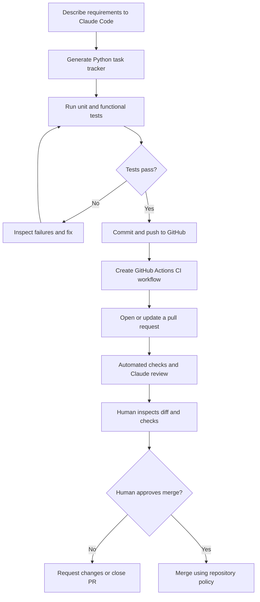

# Day 2 – Claude Code for DevOps: GitHub, CI, and Pull Request Reviews

## Overview
Day 2 demonstrates an end-to-end AI-assisted DevOps workflow using Claude Code, a Python CLI task tracker, Git/GitHub, GitHub Actions, and pull requests (PRs).

The main objective is not simply to generate application code. It is to use an AI coding agent to help test code, create CI workflows, work with Git branches and PRs, and review proposed changes while keeping important decisions under human control.

## Learning Objectives
- Explain the difference between code generation and an agentic development workflow.
- Build and test a small Python CLI task tracker with Claude Code.
- Use Git and GitHub to version and publish a project.
- Configure Claude's GitHub integration and repository secrets safely.
- Understand how GitHub Actions can run tests on pushes and pull requests.
- Use Claude-assisted PR reviews to identify possible bugs and review changes.
- Keep final merge approval under human control.
- Understand common setup and troubleshooting steps.

## Session Workflow

## Files in This Module
- [Concepts](concepts.md)
- [Task Tracker Practical](task-tracker-practical.md)
- [GitHub Setup](github-setup.md)
- [GitHub Actions CI](github-actions-ci.md)
- [Pull Request Review](pull-request-review.md)
- [Security Best Practices](security-best-practices.md)
- [Troubleshooting](troubleshooting.md)
- [Reusable Prompts](prompts.md)
- [Workflow Diagram](diagrams/workflow.md)

## Practical Scope
The class demonstrated the overall workflow and generated a GitHub Actions workflow with Claude Code. Detailed workflow YAML teaching was deferred to later CI/CD or Jenkins classes. Treat the actual workflow file generated in your repository as the source of truth and review its triggers, permissions, and actions before using it.

## Important Safety Rule
Claude can assist with code changes, testing, and reviews. A human should inspect the proposed changes and retain merge approval, especially for production repositories. Do not grant broad write or merge permissions merely for convenience.

## Suggested Practice Checklist
- [ ] Build the task tracker and inspect the generated files.
- [ ] Run the test suite and investigate failures.
- [ ] Review `.gitignore` before publishing.
- [ ] Push the project to a GitHub repository.
- [ ] Add the Claude GitHub App/integration only after reviewing requested permissions.
- [ ] Store API credentials in GitHub Actions secrets, never in source files.
- [ ] Add or inspect the CI workflow.
- [ ] Create a feature branch and open a PR.
- [ ] Review automated checks, Claude's comments, and the code diff.
- [ ] Merge only after human review and required checks pass.
