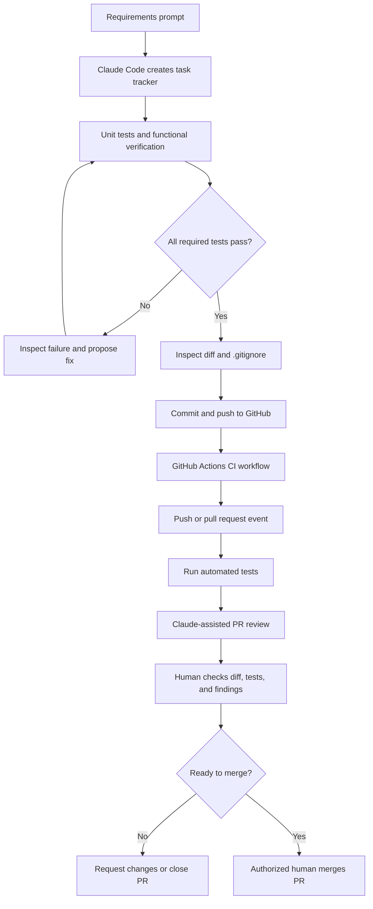

# Day 2 Workflow Diagram

## End-to-End Flow

## Responsibility Split

| Activity | Claude Code / automation | Human |
|---|---|---|
| Generate application draft | Assists | Defines and verifies requirements |
| Run tests and diagnose failures | Assists; executes configured commands | Reviews results and edge cases |
| Create CI workflow | Generates proposed YAML | Reviews triggers, permissions, and correctness |
| Review PR | Produces findings if configured | Evaluates findings and full diff |
| Merge PR | Only if explicitly configured and authorized | Retains final approval in this learning workflow |
| Manage credentials | Uses configured secret reference | Creates, scopes, rotates, and protects credentials |
